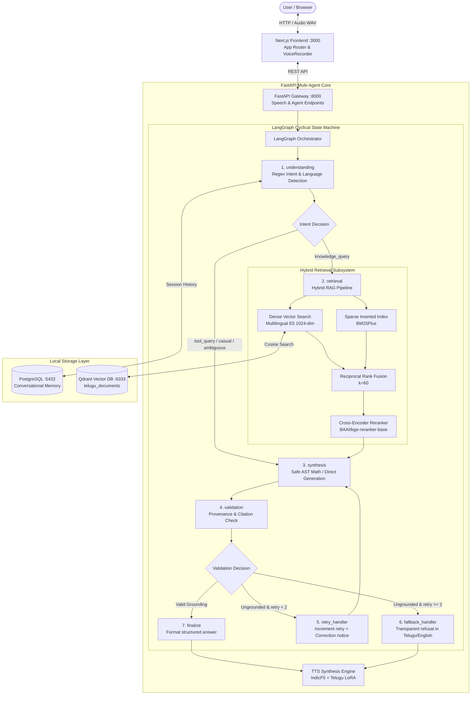
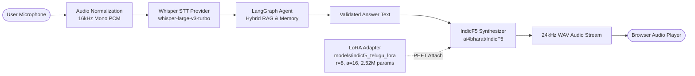

# Multi-Agent Telugu Conversational AI

**A local-first multilingual conversational RAG platform with hybrid retrieval, cyclical LangGraph state orchestration, voice interaction, and domain-adapted IndicF5 speech synthesis.**

---

> [!NOTE]
> **LOCAL-FIRST RESEARCH & PROTOTYPE PLATFORM**  
> This system is designed for local execution, academic research, technical interviews, and viva demonstration. All core services (FastAPI gateway, Next.js workspace, PostgreSQL relational memory, Qdrant vector database, Whisper ASR, IndicF5 TTS, and the LoRA adapter) run locally. Cloud GPU hardware (Google Colab Tesla T4) was utilized strictly as an offline training accelerator for parameter-efficient adaptation. No cloud deployment infrastructure is required.

---

## Architecture & Value Summary

* **Hybrid Retrieval:** Dense Multilingual E5 embeddings (1024-dim) + Sparse BM25Plus lexical indexing fused via Reciprocal Rank Fusion (RRF, $k=60$) and reranked with a cross-encoder (`bge-reranker-base`).
* **Cyclical LangGraph Orchestrator:** 7-node state machine workflow managing intent routing, safe AST mathematical evaluation, provenance validation, and bounded retry loops.
* **Bilingual Voice Pipeline:** Local Whisper Large v3 Turbo STT and neural flow-matching diffusion TTS using `ai4bharat/IndicF5` with 24 kHz Vocos vocoder.
* **Parameter-Efficient Speech Adaptation (LoRA):** Low-rank adaptation ($r=8, \alpha=16$, 2.52M weights, 0.7511% of base DiT) fine-tuned on a 140-sample multi-speaker Telugu dataset, reducing domain Character Error Rate from **`5.36%`** to **`1.81%`** ($-66.23\%$ relative reduction).
* **Conversational Relational Memory:** PostgreSQL 16 relational storage for multi-turn session persistence with automatic in-memory SQLite fallback for offline execution.
* **Safe Deterministic Tooling:** Abstract Syntax Tree (AST) arithmetic parser with operator whitelisting and depth bounds, eliminating `eval()` code injection risks.

---

## 1. Problem Statement & Technical Contributions

### The Problem
Deploying conversational AI in Indic languages presents distinct challenges:
1. **Code-Mixed Terminology:** Academic and institutional documents frequently mix Telugu script with English technical loanwords (e.g., *“revaluation fee”*, *“hall ticket”*, *“credits”*) that standard zero-shot speech and text models fail to synthesize or ground accurately.
2. **Lexical vs. Semantic Blind Spots:** Pure dense vector search misses exact numeric thresholds (e.g., *“75% attendance”*), while pure keyword search misses paraphrased queries in Telugu.
3. **Hallucination & Provenance:** Standard single-step RAG pipelines generate ungrounded answers when retrieved documents lack sufficient evidence.
4. **Zero-Shot TTS Pronunciation Errors:** Pre-trained IndicF5 diffusion models transliterate English loanwords into inaccurate phonetic script and expand digits into Telugu number words unpredictably.

### Technical Contributions
* **Hybrid Fusion Retrieval:** Fuses dense vector similarity with sparse BM25Plus using Reciprocal Rank Fusion ($k=60$) and cross-encoder reranking, achieving 1.00 MRR@5 and Recall@5 on bilingual domain queries.
* **State Machine Agent DAG:** Implements a cyclical LangGraph workflow with deterministic regex intent routing, AST tool evaluation, and citation verification with bounded retries (max 2) and language-matched refusal fallbacks.
* **Diffusion Transformer LoRA Adaptation:** Adapts 132 linear projections across 22 transformer blocks in IndicF5's DiT backbone with 100% frozen base weights, dramatically improving technical loanword retention and numeric stability.
* **Empirical Live-Audio Benchmark:** Quantitatively validates phonetic intelligibility improvements using an automated live-audio round-trip pipeline (Text $\to$ Neural WAV $\to$ Whisper Large v3 Turbo $\to$ CER/WER calculation) over a 120-sentence domain benchmark and a 14-sample held-out acoustic test set.

---

## 2. System Architecture



### Voice Pipeline Flow


---

## 3. Hybrid RAG Pipeline

```text
Target Document (PDF)
        ↓
PyMuPDF Page Parser
        ↓
Structure-Aware Chunker (600 chars, 120 overlap, split on '।' and '\n\n')
        ↓
Dense Embeddings (Multilingual E5)  +  Sparse Inverted Index (BM25Plus)
        ↓                                       ↓
Qdrant Vector Search (Cosine)         BM25 Lexical Matching
        ↓                                       ↓
        └───────────────┬───────────────────────┘
                        ↓
            Reciprocal Rank Fusion (RRF)
            Score = Σ (weight_m / (60 + rank_m))
                        ↓
            Cross-Encoder Reranker (BGE)
                        ↓
            Top-K Context Chunks to Agent
```

* **Chunking Strategy:** [StructureAwareChunker](ai-service/app/ingestion/chunker.py) preserves Telugu sentence terminators (dandas `।`, periods, exclamation marks) and paragraph structures, generating deterministic SHA-256 chunk IDs.
* **Dense Retrieval:** Generates 1024-dimensional vectors with `intfloat/multilingual-e5-large` with task prefixes (`passage: ` and `query: `).
* **Sparse Lexical Search:** [BM25Index](ai-service/app/retrieval/bm25.py) tokenizes Telugu morphological variants and preserves numbers, currency symbols, and acronyms.
* **Reciprocal Rank Fusion:** Combines dense and sparse ranked lists using $RRF(d) = \sum_{m} \frac{w_m}{k + \text{rank}_m(d)}$ with smoothing constant $k=60$.
* **Contextual Reranking:** [BGEReranker](ai-service/app/retrieval/reranker.py) scores candidate pairs $(query, passage)$ to ensure top relevance.

---

## 4. LangGraph Agentic Workflow

The orchestrator compiles a cyclical State Graph using `langgraph.graph.StateGraph(AgentState)` with 7 isolated nodes:

| Node | File | Responsibility |
| :--- | :--- | :--- |
| **`understanding`** | [understanding.py](ai-service/app/agents/nodes/understanding.py) | Classifies intent (`knowledge_query`, `tool_query`, `casual_query`, `ambiguous_query`) and detects language (`te`, `en`, `mixed`). |
| **`retrieval`** | [retrieval.py](ai-service/app/agents/nodes/retrieval.py) | Executes hybrid retrieval only for knowledge queries; non-retrieval intents bypass this node. |
| **`synthesis`** | [synthesis.py](ai-service/app/agents/nodes/synthesis.py) | Evaluates arithmetic queries via safe AST parsing, or formats context-grounded LLM prompts. |
| **`validation`** | [validation.py](ai-service/app/agents/nodes/validation.py) | Checks answer grounding, verified citation formatting, and page number overlap. |
| **`retry_handler`** | [graph.py](ai-service/app/agents/graph.py#L43) | Increments retry counter and injects corrective feedback prompt when validation fails. |
| **`fallback_handler`** | [graph.py](ai-service/app/agents/graph.py#L51) | Returns transparent refusal in user's detected language when maximum retries (2) are exceeded. |
| **`finalize`** | [graph.py](ai-service/app/agents/graph.py#L65) | Assembles final response payload with citations, timings, and metadata. |

### Safe AST Calculator Tool
To eliminate code injection risks from unrestricted `eval()`, the calculator tool ([calculator.py](ai-service/app/agents/tools/calculator.py)) parses expressions into Python Abstract Syntax Trees (`ast.parse`) with strict safety constraints:
* **Allowed AST Nodes:** `Add`, `Sub`, `Mult`, `Div`, `FloorDiv`, `Mod`, `Pow`, `USub`, `UAdd`, and numeric `Constant`.
* **Safety Limits:** Exponentiation bounded to $exponent \le 100$; depth recursion bounded.
* **Error Handling:** Explicitly catches `ZeroDivisionError` and returns clean, friendly messages.

---

## 5. Parameter-Efficient Speech Adaptation (LoRA on IndicF5)

* **Base Model Backbone:** `ai4bharat/IndicF5` Diffusion Transformer (DiT) with 335,924,324 base parameters (100% frozen).
* **LoRA Configuration:** Rank $r=8$, Scaling factor $\alpha=16$, Dropout $0.05$.
* **Target Linear Projections (132 modules across 22 DiT blocks):**
  * Multi-Head Attention: `to_q`, `to_k`, `to_v`, `to_out.0` (88 instances)
  * Feed-Forward Network: `ff.ff.0.0`, `ff.ff.2` (44 instances)
* **Trainable Parameters:** **`2,523,136`** weights (**`0.7511%`** of base DiT backbone).
* **Adapter Checkpoint:** 10.1 MB serialized in [`models/indicf5_telugu_lora/adapter_model.safetensors`](models/indicf5_telugu_lora/adapter_model.safetensors).
* **Training Dataset:** 140 studio-recorded Telugu samples (~17.87 minutes across 3 speakers: IndicTTS female, SYSPIN female, SYSPIN male) with a stratified 112 train / 14 val / 14 test split.
* **Training Convergence:** Initial validation loss `0.763900` converged to **`0.284200`** at **Epoch 44** (Google Colab Tesla T4 GPU).

---

## 6. Verified Experimental Results

All reported metrics reflect **live audio round-trip evaluation** (Target Text $\to$ Neural Diffusion Synthesis $\to$ WAV Audio $\to$ Whisper Large v3 Turbo ASR $\to$ Hypothesis Transcription $\to$ Levenshtein CER/WER calculation):

### Full 120-Sentence Domain Benchmark (Phase 7)
Evaluated across all 120 domain sentences from [`dataset/telugu_tts/sentence_manifest.json`](dataset/telugu_tts/sentence_manifest.json):

| Metric / Category | Sample Count | Base IndicF5 | IndicF5 + LoRA (Epoch 44) | Relative Improvement |
| :--- | :---: | :---: | :---: | :---: |
| **Overall Character Error Rate (CER)** | **120** | `5.36%` (0.0536) | **`1.81%`** (0.0181) | **`-66.23% relative reduction`** |
| **Overall Word Error Rate (WER)** | **120** | `17.86%` (0.1786) | **`13.25%`** (0.1325) | **`-25.81% relative reduction`** |
| **Technical / Code-Mixed CER** | 35 | `7.63%` (0.0763) | **`1.47%`** (0.0147) | **`-80.73% relative reduction`** |
| **Numeric / Percentage CER** | 20 | `10.39%` (0.1039) | **`2.19%`** (0.0219) | **`-78.92% relative reduction`** |
| **Academic / Institutional CER** | 35 | `2.91%` (0.0291) | **`1.56%`** (0.0156) | **`-46.39% relative reduction`** |
| **General Telugu CER** | 30 | `2.23%` (0.0223) | **`2.23%`** (0.0223) | **`0.00% (zero degradation)`** |
| **Domain Terminology Accuracy** | 220 terms | `75.00%` (165/220) | **`88.18%`** (194/220) | **`+13.18% absolute gain`** |
| **Held-Out Acoustic Test CER (`test.csv`)** | 14 samples | `3.67%` (0.0367) | **`3.67%`** (0.0367) | **`Preserves native voice quality`** |
| **Tesla T4 Synthesis Latency** | 120 runs | `0.688 s` | **`0.703 s`** | **`+2.2% overhead (negligible)`** |

> [!IMPORTANT]
> **Research Transparency Note on Historical Phase 6D Results:**  
> An initial Phase 6D test script returned an artificial 0.0000 CER / 0.0000 WER due to a ground-truth string comparison bug in the evaluation harness. This was formally audited, marked `INVALID_AUDITED`, and replaced with genuine live audio decoding pipelines in [`evaluation/evaluate_phase7.py`](evaluation/evaluate_phase7.py). Round-trip CER/WER evaluates phonetic intelligibility and ASR transcription accuracy, but does not directly measure human-perceived acoustic pleasantness.

---

## 7. Technology Stack

| Layer | Technology | Version / Model | Purpose |
| :--- | :--- | :--- | :--- |
| **Frontend Workspace** | Next.js, React, TypeScript | 15.5 / 19.0 | App Router, voice recording, citations, dark SaaS UI |
| **Backend Gateway** | FastAPI, Pydantic v2, Uvicorn | 0.115+ | Async REST API, audio streaming, dependency injection |
| **Agent Orchestration** | LangGraph, LangChain Core | 0.2.70+ | Stateful cyclical DAG, intent routing, bounded retries |
| **Primary LLM** | Google Gemini API (REST) | `gemini-1.5-flash` | Multilingual reasoning, context synthesis, Telugu generation |
| **Dense Embeddings** | FastEmbed | `intfloat/multilingual-e5-large` | 1024-dim multilingual representations |
| **Sparse Search** | `rank_bm25` (BM25Plus) | $k_1=1.5, b=0.75$ | Lexical keyword matching for numbers and loanwords |
| **Reranker** | Cross-Encoder | `BAAI/bge-reranker-base` | Neural contextual reranking |
| **Vector Database** | Qdrant | Docker `:6333` | Dense vector storage with Cosine similarity |
| **Relational Database** | PostgreSQL 16 + SQLAlchemy | Docker `:5432` | Multi-turn conversational memory & session persistence |
| **Speech-to-Text (STT)** | Whisper | `openai/whisper-large-v3-turbo` | Telugu & code-mixed speech recognition |
| **Text-to-Speech (TTS)** | IndicF5 + Vocos | `ai4bharat/IndicF5` | Flow-matching neural diffusion speech synthesis |
| **Fine-Tuning (PEFT)** | Hugging Face PEFT | LoRA ($r=8, \alpha=16$) | Low-rank adaptation of DiT backbone |
| **Audio Processing** | SoundFile, PyDub, SciPy | Standard PCM 16-bit | Decoding, resampling (16/24kHz), RMS silence check |


---

## 8. Repository Structure

```text
.
├── README.md                          # Master documentation & setup guide
├── docker-compose.yml                 # Local PostgreSQL and Qdrant services
├── .env.example                       # Centralized configuration template
├── ai-service/                        # FastAPI backend application
│   ├── app/
│   │   ├── main.py                    # API routes, lifecycle, and dependency injection
│   │   ├── config.py                  # Pydantic settings management
│   │   ├── schemas.py                 # Request and response models
│   │   ├── rag.py                     # Hybrid retrieval pipeline orchestrator
│   │   ├── agents/                    # LangGraph StateGraph, nodes, and AST calculator
│   │   ├── embeddings/                # FastEmbed provider wrapper
│   │   ├── storage/                   # Qdrant client & PostgreSQL memory manager
│   │   └── speech/                    # Whisper STT & IndicF5 LoRA TTS providers
│   └── requirements.txt               # Backend Python dependencies
├── frontend/                          # Next.js 15 TypeScript application
│   ├── app/                           # App Router pages and globals.css
│   ├── components/                    # Chat, document upload modal, audio player, UI
│   └── lib/api/                       # Type-safe API client and data models
├── models/
│   └── indicf5_telugu_lora/           # Saved LoRA adapter weights (Epoch 44, 10.1 MB)
├── dataset/telugu_tts/                # Multi-speaker dataset manifests & 120-sentence benchmark
├── evaluation/                        # Standalone quantitative evaluation scripts & results JSON
├── tests/                             # Automated test suite (97 tests collected)
└── docs/
    ├── ARCHITECTURE.md                # System specification & database schemas
    ├── RESEARCH.md                    # Research methodology, loss curves, & reproducibility matrix
    └── PROJECT_STATUS.md              # Milestone tracking & verification ledger
```

---

## 9. Local Setup & Execution Guide

### Prerequisites
* **OS:** macOS (Apple Silicon / Intel), Linux, or Windows (WSL2)
* **Python:** Version 3.11+
* **Node.js:** Version 18.0+ & npm
* **Docker & Docker Compose:** For local PostgreSQL and Qdrant instances

---

### Step 1: Clone Repository & Configure Environment
```bash
git clone https://github.com/sathvikreddy369/voice-agent.git
cd voice-agent

# Copy environment configuration template
cp .env.example .env

# Configure your Gemini API key in .env
# GEMINI_API_KEY=your_gemini_api_key_here
```


---

### Step 2: Start Local Databases
```bash
docker compose up -d
```
Verifies:
* **PostgreSQL Relational DB:** `localhost:5432` (`telugu_ai_db`)
* **Qdrant Vector DB:** `localhost:6333`

---

### Step 3: Start FastAPI Backend
```bash
# Create and activate virtual environment
python3 -m venv .venv
source .venv/bin/activate

# Install dependencies
pip install -r ai-service/requirements.txt

# Start backend server
PYTHONPATH=ai-service uvicorn app.main:app --app-dir ai-service --host 0.0.0.0 --port 8000 --reload
```
API Documentation (Swagger UI): **`http://localhost:8000/docs`**

---

### Step 4: Start Next.js Frontend
```bash
# In a separate terminal:
cd frontend
npm install
npm run dev
```
Open **`http://localhost:3000`** in your browser.

---

## 10. Speech & LoRA Adapter Configuration

The active speech engine and adapter are configured in `.env`:

```env
# Option 1: IndicF5 Diffusion with Trained Telugu LoRA Adapter (Default / Recommended)
TTS_ENGINE=indicf5
TTS_ADAPTER=models/indicf5_telugu_lora

# Option 2: Zero-Shot Baseline IndicF5 (No Adapter)
TTS_ENGINE=indicf5
TTS_ADAPTER=none

# Option 3: Fast Acoustic Fallback Synthesizer (~2ms, for rapid offline development)
TTS_ENGINE=fallback
```

Every response header (`X-TTS-Engine`, `X-TTS-Adapter`, `X-TTS-Is-Fallback`) and the `/health` endpoint transparently report the active engine.

---

## 11. Automated Testing & Verification

```bash
# Run comprehensive test suite (97 tests: 84 unit tests, 13 live service integration tests)
pytest tests/ -v

# Run Next.js production build & TypeScript type checking
cd frontend && npm run build
```

---

## 12. Documentation Navigation

* **[START_GUIDE.md](START_GUIDE.md):** Quick-start user guide, retrieval mode selection matrix, and step-by-step example test workflows.
* **[docs/ARCHITECTURE.md](docs/ARCHITECTURE.md):** Complete architectural specification, database schemas (`conversations`, `messages`), and detailed subsystem data flows.
* **[docs/RESEARCH.md](docs/RESEARCH.md):** Formal research objectives, loss convergence curves, reproducibility matrix, and category-level breakdown tables.
* **[docs/PROJECT_STATUS.md](docs/PROJECT_STATUS.md):** Chronological milestone ledger tracking Phases 0 through 8 with verification records.


---

## 13. Methodological Limitations

1. **ASR Round-Trip vs. Perceptual Naturalness:** CER and WER measured through Whisper ASR evaluate phonetic transcription accuracy and intelligibility; they do not directly measure subjective prosody or acoustic pleasantness.
2. **Adaptation Corpus Scale:** The LoRA fine-tuning corpus was ~17.87 minutes across 3 speakers; gains are domain-specific rather than a universal voice identity transformation.
3. **Local CPU Latency:** Local neural diffusion inference on Apple Silicon CPU is computationally intensive (~18s per utterance); the in-memory acoustic fallback provider is provided for instant local offline testing.
4. **Local-First Scope with Gemini API:** The application is local-first: Qdrant (local vector DB), PostgreSQL (local relational memory), FastEmbed (local embeddings), BM25Plus (local sparse retrieval), BGE (local reranking), Whisper (local STT), and IndicF5 + LoRA (local TTS) run entirely locally. The Google Gemini API is utilized strictly for multilingual reasoning and text answer generation over HTTPS.


---

## 14. Scope & Positioning

* **Strictly Local-First Research & Prototype:** Designed for major project evaluation, viva defense, resume review, and academic presentation.
* **No Cloud Deployment Required:** Deployment to Kubernetes, AWS, GCP, Azure, Vercel, or Render is intentionally excluded from the project scope.
