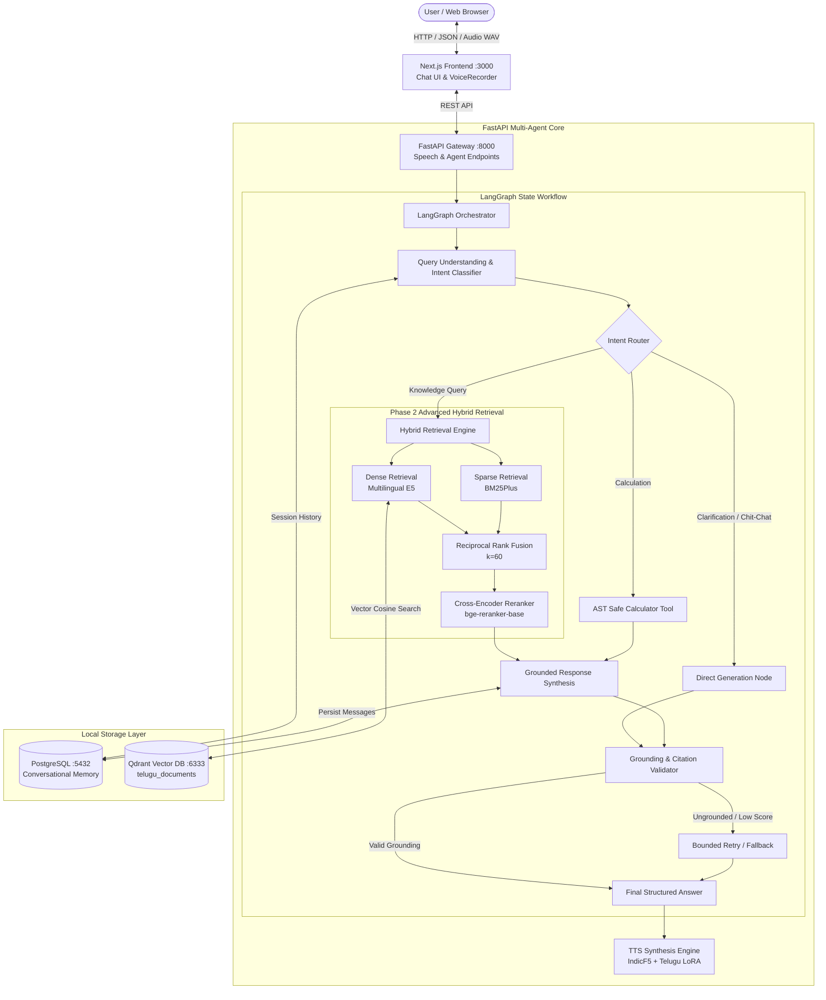
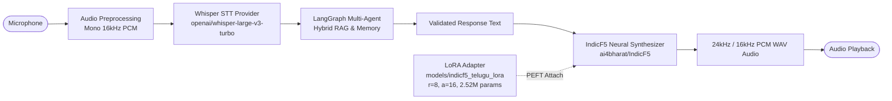
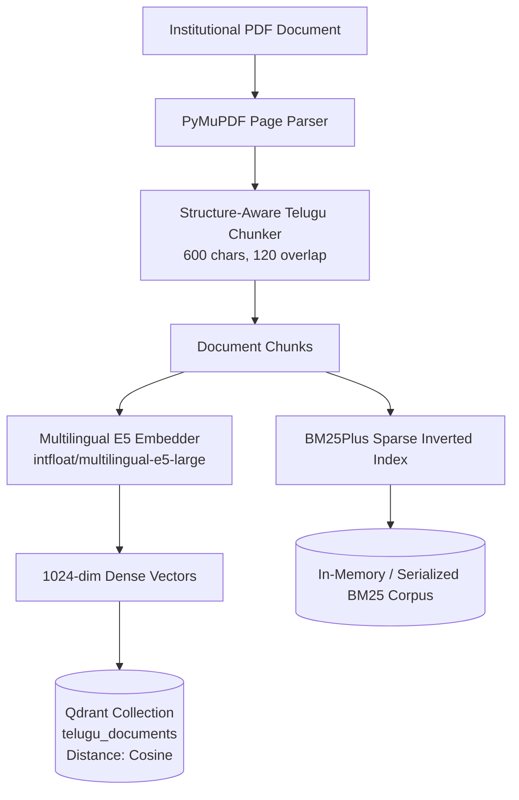

# System Architecture Specification

**Project:** Multi-Agent Telugu Conversational AI with Retrieval-Augmented Generation and Adaptive Speech Synthesis  
**Architecture Version:** 2.2.0 (Phase 8 Final Demo & Research Release)  
**Execution Environment:** Local-Only (FastAPI + Next.js + PostgreSQL + Qdrant + Local PyTorch Models)

---

## 1. Overall System Architecture



---

## 2. End-to-End Voice Pipeline



---

## 3. Ingestion & RAG Data Flow



---

## 4. LoRA Training & Live Evaluation Pipeline

```mermaid
flowchart TD
    subgraph DatasetPreparation [Phase 6B Multi-Source Dataset]
        IndicTTS[IndicTTS Female\n60 samples, 7.04 min] --> Assembly[Hybrid Dataset Pipeline]
        SYSPINF[SYSPIN Female\n40 samples, 5.76 min] --> Assembly
        SYSPINM[SYSPIN Male\n40 samples, 5.07 min] --> Assembly
        Assembly --> Split[Stratified Leakage-Free Split\nTrain: 112, Val: 14, Test: 14]
    end

    subgraph ColabTraining [Colab Tesla T4 CUDA Acceleration]
        Split -->|Train & Val Splits| Train[LoRA Fine-Tuning\nAdamW, Cosine Warmup, 50 Epochs]
        BaseIndicF5[Base IndicF5 335.9M DiT\n100% Frozen] --> Train
        LoRATargets[LoRA Projections: to_q, to_k, to_v,\nto_out.0, ff.ff.0.0, ff.ff.2] --> Train
        Train --> BestCkpt[Epoch 44 Best Checkpoint\nVal Loss: 0.284200]
        BestCkpt --> Adapter[Export Adapter\nmodels/indicf5_telugu_lora\n10.1 MB, 2.52M weights (0.7511%)]
    end


    subgraph EvaluationAudit [Phase 6D & 7 Live Whisper Benchmarks]
        Adapter --> LocalTTS[Local FastAPI Integration\nTTS_ADAPTER=models/indicf5_telugu_lora]
        Manifest[120-Sentence Manifest & 14-sample Test Set] --> GenWAV[Live Physical WAV Synthesis]
        GenWAV --> LiveWhisper[Live Whisper Decoding\nwhisper-large-v3-turbo]
        LiveWhisper --> MetricEval[CER / WER / Terminology Evaluation]
    end
```

---

## 5. Relational Database Schema (PostgreSQL)

The relational database maintains persistent multi-turn conversational memory and session tracking.

### 5.1 Tables & Relationships

```sql
-- Conversations Table
CREATE TABLE conversations (
    id VARCHAR(36) PRIMARY KEY,                  -- UUID v4 string
    created_at TIMESTAMP WITH TIME ZONE NOT NULL, -- UTC creation timestamp
    updated_at TIMESTAMP WITH TIME ZONE NOT NULL  -- UTC last update timestamp
);

-- Messages Table
CREATE TABLE messages (
    id VARCHAR(36) PRIMARY KEY,                  -- UUID v4 string
    conversation_id VARCHAR(36) NOT NULL REFERENCES conversations(id) ON DELETE CASCADE,
    role VARCHAR(20) NOT NULL,                   -- 'user' | 'assistant'
    content TEXT NOT NULL,                       -- Message text in Telugu / English
    intent VARCHAR(50) NULL,                     -- Classified query intent
    created_at TIMESTAMP WITH TIME ZONE NOT NULL -- UTC creation timestamp
);

-- Indexes
CREATE INDEX ix_messages_conversation_id ON messages (conversation_id);
CREATE INDEX ix_messages_created_at ON messages (created_at);
```

### 5.2 Storage Fallback
If the PostgreSQL Docker container is offline or unreachable, `PostgresManager` initializes an in-memory SQLite database (`sqlite:///:memory:`) dynamically to allow uninterrupted development and local test execution.

---

## 6. Vector Database Configuration (Qdrant)

* **Collection Name:** `telugu_documents` (configurable via `QDRANT_COLLECTION_NAME`)
* **Vector Dimension:** `1024` (matches `intfloat/multilingual-e5-large`)
* **Distance Metric:** `Cosine`
* **Payload Fields:**
  * `document_id` (string)
  * `chunk_id` (string)
  * `source` (string, filename)
  * `page` (integer, 1-indexed)
  * `chunk_index` (integer, 0-indexed)
  * `text` (string, chunk text)
  * `char_count` (integer)
